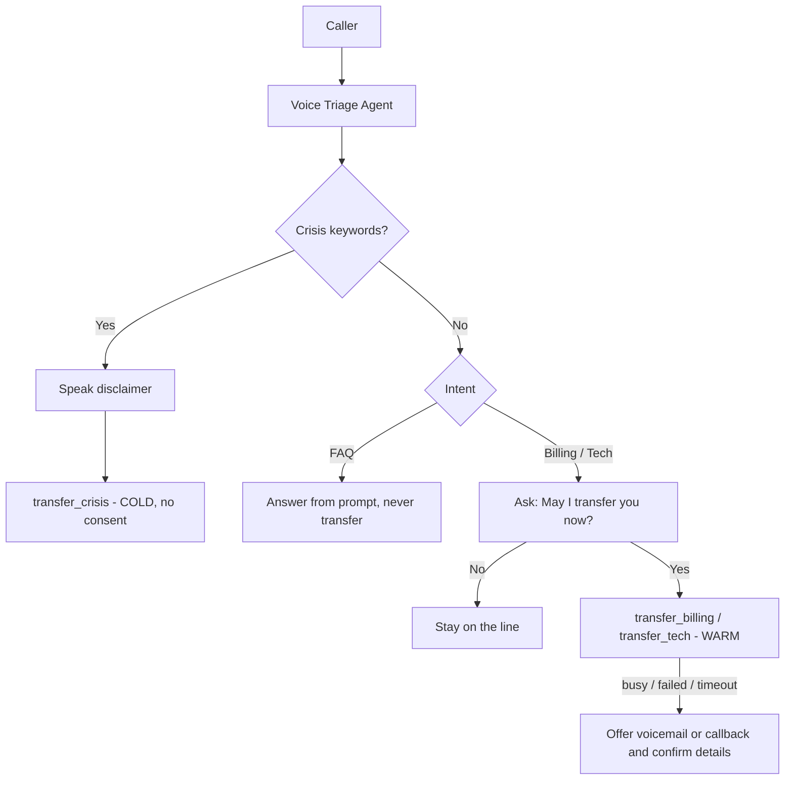

# Retell AI Voice Triage Agent: Human Transfer, Escalation & Safety Boundaries

Lesson 10 assessment. A Retell AI voice agent that answers simple FAQs, transfers billing and technical issues to specialists (warm transfer) only after verbal consent, escalates emergencies instantly to a crisis line (cold transfer, consent bypassed), and falls back to voicemail/callback when a transfer fails.

**Demo video:** https://www.loom.com/share/8cc9ffc52485482ea10d58c0a615fda6

## Architecture

## Repository structure
| Path | Purpose |
|---|---|
| `prompts/system_prompt.md` | Final agent prompt (crisis, FAQ, consent, transfer, fallback) |
| `config/retell_functions.json` | The three Retell transfer functions (warm/cold, 30s ring) with placeholder numbers |
| `config/routing_matrix.json` | Routing rules summary |
| `src/webhook_server.py` | Call-status webhook: Bearer token auth (401), fallback mapping on SIP 486/480 |
| `tests/test_cases.md` | Test cases with execution results |
| `tests/test_webhook.py` | Automated webhook tests (4) |
| `docs/` | Verification checklist, demo outline, screenshots of each tested scenario |

## Setup
1. In Retell create a Single-Prompt agent and paste `prompts/system_prompt.md`.
2. Add three **Call Transfer** functions as in `config/retell_functions.json` (billing/tech: Warm, crisis: Cold, ring duration 30s) with your own E.164 numbers.
3. Publish the agent. Test with the **Test LLM** tab to see tool calls.
4. Optional webhook: `export WEBHOOK_TOKEN=... && python -m src.webhook_server`, then point Retell's webhook to `/webhook/call-status` with header `Authorization: Bearer <token>`.
5. Automated tests: `python -m unittest tests.test_webhook`

## Implementation notes
- Crisis rule is first in the prompt and explicitly overrides every other rule, including consent.
- Billing and tech use warm transfers (context passed to the human); crisis uses a cold transfer for speed.
- The agent calls a transfer tool only on a clear "yes". A decline keeps the caller on the line.
- Simple questions (balance, hours, password reset) are answered from the prompt and never transferred.
- On busy, failed or timed-out transfers the agent offers voicemail or callback and reads the details back.
- Webhook compares tokens with `hmac.compare_digest` and returns 401 on an invalid token.

## Assumptions
- Destination numbers are active; test numbers were used during development.
- Retell supports tool responses/callbacks for transfer status.
- FAQ content is small enough to live in the prompt (no knowledge base needed).

## Challenges
- Retell **web calls do not support call transfer**, so transfers were verified through Test LLM tool-call/tool-response logs instead of live phone transfers.
- The busy-line failure was simulated by sending a message ("The transfer failed, the line is busy.") because a real failure could not be triggered in web testing.
- Making the crisis override reliably beat the consent flow was solved with strict priority ordering and an exact script.

## Additional features
- Timing-safe webhook token validation and fallback mapping for SIP 486/480.
- FAQ no-transfer rule (TC-006).
- Callback collection with read-back confirmation.
- Possible next steps: real SIP busy tests with a purchased number, business-hours check, a CRM write on call completion.

> Phone numbers in this repo are placeholders. This is a training project and must not be relied on for real emergency response.
